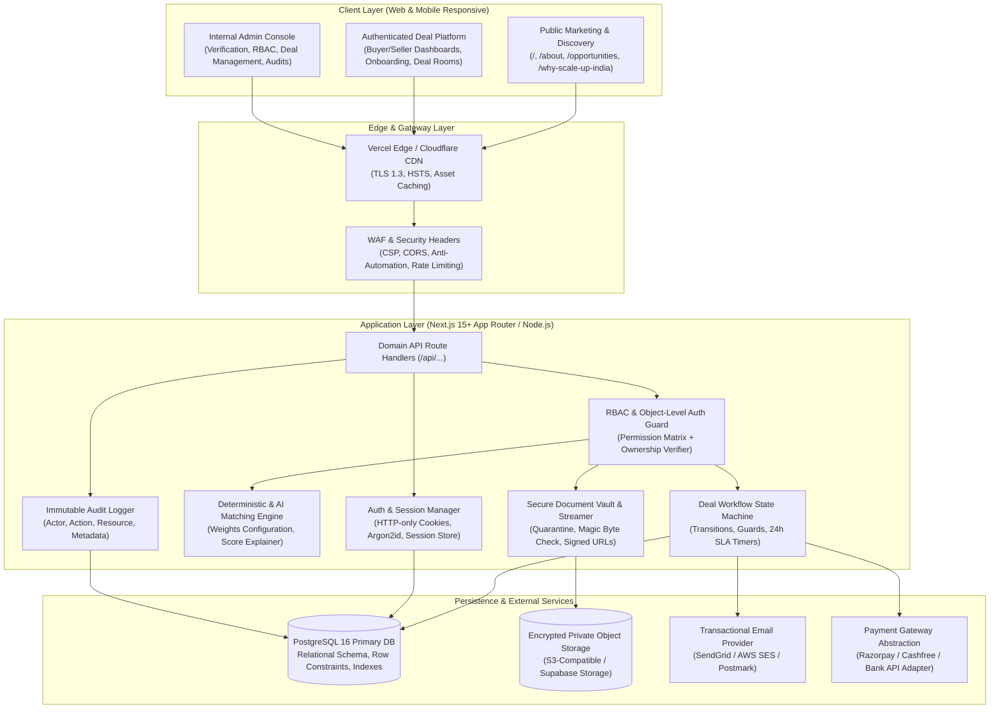

# Scale-up India — System Architecture Specification (ARCHITECTURE.md)
*Operated under Ideal Corporate Synergy LLP (ICS)*

---

## 1. System Philosophy & Architecture Principles

Scale-up India is an enterprise-grade, confidential business matchmaking and transaction orchestration platform. It is not an open directory or a classifieds portal (like OLX or IndiaMART). It is an institutional deal room that connects business promoters/sellers with verified buyers, investors, and strategic partners while safeguarding business identity, financial records, and operational secrets.

### Core Principles
1. **Confidentiality by Design**: Business names, CIN numbers, promoter identities, exact addresses, and sensitive financial records are protected behind progressive authorization tiers (Public/Masked $\to$ Verified $\to$ NDA Signed $\to$ Deal Room Access).
2. **Deterministic State Machine**: Deal lifecycles, buyer-seller interests, MOUs, due diligence, and share transfer agreements (STAs) transition exclusively through validated, idempotent state machines with strict server-side authorization.
3. **Defense-in-Depth & Zero Client Trust**: No client-supplied role, status, ID, or calculation is trusted. All operations enforce object-level authorization (IDOR mitigation), strict input whitelisting (preventing mass assignment), and immutable audit logging.
4. **Integration-Ready Custodianship / Escrow Architecture**: Custodianship and token workflows are modeled as a robust state engine with provider abstractions (`PaymentProvider`, banking ledger) without making false legal claims of holding regulated financial licenses.
5. **Human-in-the-Loop Verification**: While rules and AI assist in scoring and semantic discovery, human verification managers and relationship managers validate identities, approve curated listings, and facilitate transactions.

---

## 2. High-Level System Architecture



---

## 3. Technology Stack

| Layer | Component | Selection & Rationale |
| :--- | :--- | :--- |
| **Framework** | Next.js 15+ (App Router) | High-performance React 19 Server Components for public SEO pages; secure Server Actions and API Route handlers for transactional deal room features. |
| **Language** | TypeScript 5.5+ (Strict Mode) | Zero-compromise typing with no implicit `any`, strict null checks, and shared Zod schemas across client and server. |
| **Styling & Design System** | Tailwind CSS v3/v4 + Headless UI + Lucide Icons | Premium enterprise brand palette (Deep Navy `#0B1F3A`, Primary Blue `#1557A6`, Secondary Blue `#2878C8`, Accent Gold/Orange `#F59E0B`, Soft Blue Surface `#EEF5FB`, Neutral `#F7F9FC`/`#101828`), WCAG 2.2 AA compliant contrast, custom accessible components. |
| **Database** | PostgreSQL 16 | Relational consistency, foreign key cascades/restricts, JSONB for extensible preferences, partial indexes for deal searches, and transactional safety. |
| **ORM / Data Access** | Prisma / Drizzle ORM | Type-safe query building with parameterization, migration tracking, and connection pooling. |
| **Validation** | Zod 3.x | Authoritative request schema validation, input sanitization, and output DTO pruning. |
| **Authentication** | Custom Enterprise Auth / Auth.js with Argon2id | Secure HTTP-only cookies, session rotation, account lockout on brute-force attempts, multi-role relationship mapping. |
| **Object Storage** | Private S3 / MinIO / Local Encrypted Storage | Zero public buckets. Multi-tenant path isolation (`/vault/{tenant_id}/{opportunity_id}/{document_id}`). Time-limited signed URLs (15-minute TTL). |
| **Asynchronous Jobs** | BullMQ / Redis / Postgres-backed Job Queue | Background 24-hour seller response SLA tracking, email dispatches, and audit trail aggregation. |
| **Testing** | Vitest + Playwright + Supertest | Unit test coverage for matching and state machines, API integration tests, and end-to-end browser tests for critical deal flows. |

---

## 4. Domain-Driven Modular Architecture

The backend code is organized into decoupled domain modules:

```
src/
├── app/                           # Next.js App Router (Routes & Layouts)
│   ├── (public)/                  # Public pages (/, /about, /how-it-works, /buy, /sell, etc.)
│   ├── (auth)/                    # Authentication pages (/login, /register, /reset-password)
│   ├── (dashboard)/               # Role-specific dashboards (/dashboard/seller, /buyer, /partner)
│   ├── (deal-room)/               # Private deal rooms (/deals/:dealId/nda, /mou, /dd, /sta)
│   ├── admin/                     # Protected internal console (/admin/opportunities, /users, etc.)
│   └── api/                       # Domain API Route Handlers
│       ├── auth/
│       ├── users/
│       ├── profiles/
│       ├── opportunities/
│       ├── matching/
│       ├── interests/
│       ├── ndas/
│       ├── mous/
│       ├── payments/
│       ├── due-diligence/
│       ├── valuation/
│       ├── transactions/
│       ├── documents/
│       ├── messages/
│       ├── notifications/
│       └── admin/
├── domains/                       # Core Business Logic (Domain Services)
│   ├── auth/                      # Password hashing, sessions, verification tokens
│   ├── profiles/                  # Promoter, Buyer, Investor profiles & readiness scoring
│   ├── opportunities/             # Listing creation, intent classification, asset sales
│   ├── matching/                  # 10-factor deterministic matching engine & AI semantic layer
│   ├── interests/                 # Expression of interest, 24h SLA counter, escalation
│   ├── legal/                     # NDA generation, Tripartite MOU, Share Transfer Agreement
│   ├── payments/                  # PaymentProvider interface, token fees, fee configuration
│   ├── due-diligence/             # 12-category DD checklist, issue tracker, evidence review
│   ├── valuation/                 # Valuation request, advisor assignment, report vault
│   ├── documents/                 # Magic byte validation, quarantine, signed URL generation
│   ├── messaging/                 # Filtered internal messaging, party-to-party relay
│   └── audit/                     # Immutable structured event logging
├── lib/                           # Shared Infrastructure
│   ├── db/                        # Database client & connection pool
│   ├── security/                  # Rate limiting, CSRF tokens, encryption helpers, sanitizers
│   ├── errors/                    # Structured domain errors (DomainError, UnauthorizedError, etc.)
│   └── storage/                   # Storage provider abstraction (S3/Local)
├── schemas/                       # Shared Zod validation contracts (DTOs)
└── types/                         # TypeScript interfaces and domain types
```

---

## 5. Security & Isolation Architecture

1. **Progressive Identity Disclosure (Data Masking)**:
   - **Tier 0 (Public Anonymous)**: Opportunity displayed as "Profitable Industrial Manufacturing Company", Sector: Manufacturing, State: North India, Revenue Band: ₹10Cr–₹25Cr. Name and CIN masked.
   - **Tier 1 (Registered & Verified Buyer)**: Detailed non-confidential metrics, operational summary, transaction intent, profile readiness score (e.g., 85/100).
   - **Tier 2 (Mutual Consent & Signed NDA)**: Legal entity name, first 15 characters of CIN, registered office state, financial highlights.
   - **Tier 3 (Active MOU & Token Paid - Deal Room)**: Full CIN, tax filings, balance sheets, statutory compliance documents, and access to the Due Diligence checklist.
2. **Anti-IDOR (Insecure Direct Object Reference) Protection**:
   - Every route handler calling `/api/deals/:id`, `/api/documents/:id`, or `/api/conversations/:id` passes through an authorization filter (`assertCanAccessDeal(userId, dealId)`). If the requesting user is neither the owner, the counterparty with an active signed agreement, nor an assigned internal advisor with corresponding RBAC permission, the request returns HTTP `404 Not Found` (or `403 Forbidden`).
3. **Document Pipeline**:
   - Files are uploaded to an isolated quarantine bucket.
   - File extension, MIME type, and magic bytes are verified.
   - Files are moved to an encrypted private bucket with a SHA-256 content checksum.
   - Documents are accessed solely through short-lived (15-minute) presigned URLs issued after verifying the user's NDA and deal state.

---

## 6. Payment & Custodianship Architecture

To satisfy regulatory accuracy without making unsubstantiated claims:
1. Scale-up India implements a `PaymentProvider` abstraction:
   - `createPayment(intent)`
   - `verifyPayment(payload, signature)`
   - `refundPayment(paymentId, reason)`
   - `getPaymentStatus(paymentId)`
2. Token fees (configurable, baseline ₹5,000) are paid by both parties upon signing the Tripartite MOU into a designated Scale-up India client funds bank account.
3. Deal milestones (e.g., STA execution, registrar share transfer filings) trigger an internal multi-signature approval workflow before consideration funds are released to the seller.
4. The platform architecture provides clear ledger statuses (`CREATED`, `PENDING_VERIFICATION`, `IN_ESCROW_ACCOUNT`, `DISBURSED`, `REFUNDED`) without advertising itself as a licensed banking/custodial entity.

---

## 7. Observability & Auditability

1. **Correlation IDs**: Every inbound HTTP request receives an `X-Correlation-ID` header, propagated through database transactions, background jobs, and logs.
2. **Structured JSON Logs**: Logs output RFC 5424 structured JSON with timestamps, log levels, request routes, user IDs, and latency. Sensitive fields (passwords, tokens, PAN, bank details) are strictly sanitized.
3. **Audit Trails**: Every sensitive action (document viewing, permission adjustment, status transition, payment verification) writes an immutable record to the `audit_logs` table.

