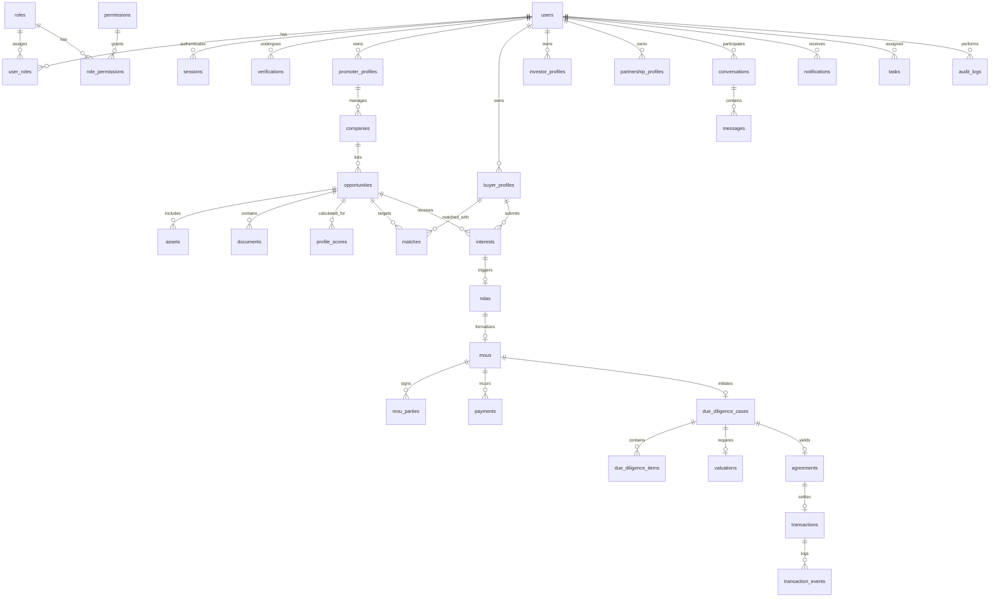

# Scale-up India — Database Schema Specification (DATABASE_SCHEMA.md)
*PostgreSQL 16 Enterprise Relational Schema*

---

## 1. Schema Design Principles
1. **Multi-Role User Architecture**: Users do not have a single hardcoded enum column. A `users` entity maps to multiple roles via `user_roles` and role-specific profile records (`promoter_profiles`, `buyer_profiles`, `investor_profiles`, `partnership_profiles`).
2. **Deterministic Data Integrity**: Strict Foreign Key constraints with appropriate `ON DELETE RESTRICT` for financial and legal entities to prevent orphaned records.
3. **Auditability & Versioning**: Critical business documents, agreements, and profiles support version tracking (`version`, `document_versions`).
4. **Soft Deletions**: Sensitive records implement `archived_at` and `deleted_at` timestamps with `deleted_by` references.
5. **Optimized Indexing**: B-tree and partial indexes for high-frequency filtering (status, sector, region, investment range, verification).

---

## 2. Entity-Relationship Overview



---

## 3. PostgreSQL DDL Specifications

```sql
-- Enable UUID extension
CREATE EXTENSION IF NOT EXISTS "uuid-ossp";
CREATE EXTENSION IF NOT EXISTS "pgcrypto";

-- ============================================================================
-- 1. AUTHENTICATION & ACCESS CONTROL (RBAC)
-- ============================================================================

CREATE TABLE users (
    id UUID PRIMARY KEY DEFAULT gen_random_uuid(),
    email VARCHAR(255) NOT NULL UNIQUE,
    phone VARCHAR(20) UNIQUE,
    password_hash VARCHAR(255) NOT NULL,
    first_name VARCHAR(100) NOT NULL,
    last_name VARCHAR(100) NOT NULL,
    is_email_verified BOOLEAN DEFAULT FALSE,
    is_phone_verified BOOLEAN DEFAULT FALSE,
    is_active BOOLEAN DEFAULT TRUE,
    is_suspended BOOLEAN DEFAULT FALSE,
    suspension_reason TEXT,
    failed_login_attempts INT DEFAULT 0,
    lockout_until TIMESTAMPTZ,
    last_login_at TIMESTAMPTZ,
    created_at TIMESTAMPTZ DEFAULT NOW(),
    updated_at TIMESTAMPTZ DEFAULT NOW(),
    deleted_at TIMESTAMPTZ
);

CREATE TABLE roles (
    id UUID PRIMARY KEY DEFAULT gen_random_uuid(),
    code VARCHAR(50) NOT NULL UNIQUE, -- 'SUPER_ADMIN', 'ADMIN', 'VERIFICATION_MANAGER', 'RELATIONSHIP_MANAGER', 'LEGAL', 'DUE_DILIGENCE', 'FINANCE', 'PROMOTER', 'BUYER', 'INVESTOR', 'PARTNER'
    name VARCHAR(100) NOT NULL,
    description TEXT,
    is_internal BOOLEAN DEFAULT FALSE,
    created_at TIMESTAMPTZ DEFAULT NOW()
);

CREATE TABLE permissions (
    id UUID PRIMARY KEY DEFAULT gen_random_uuid(),
    code VARCHAR(100) NOT NULL UNIQUE, -- e.g., 'opportunities.verify', 'documents.download'
    module VARCHAR(50) NOT NULL,
    description TEXT,
    created_at TIMESTAMPTZ DEFAULT NOW()
);

CREATE TABLE role_permissions (
    role_id UUID NOT NULL REFERENCES roles(id) ON DELETE CASCADE,
    permission_id UUID NOT NULL REFERENCES permissions(id) ON DELETE CASCADE,
    PRIMARY KEY (role_id, permission_id)
);

CREATE TABLE user_roles (
    user_id UUID NOT NULL REFERENCES users(id) ON DELETE CASCADE,
    role_id UUID NOT NULL REFERENCES roles(id) ON DELETE RESTRICT,
    assigned_at TIMESTAMPTZ DEFAULT NOW(),
    assigned_by UUID REFERENCES users(id),
    PRIMARY KEY (user_id, role_id)
);

CREATE TABLE sessions (
    id UUID PRIMARY KEY DEFAULT gen_random_uuid(),
    user_id UUID NOT NULL REFERENCES users(id) ON DELETE CASCADE,
    token_hash VARCHAR(255) NOT NULL UNIQUE,
    ip_hash VARCHAR(64),
    user_agent TEXT,
    expires_at TIMESTAMPTZ NOT NULL,
    created_at TIMESTAMPTZ DEFAULT NOW(),
    revoked_at TIMESTAMPTZ
);

CREATE TABLE organizations (
    id UUID PRIMARY KEY DEFAULT gen_random_uuid(),
    name VARCHAR(255) NOT NULL,
    slug VARCHAR(100) NOT NULL UNIQUE,
    legal_entity_type VARCHAR(100) DEFAULT 'LLP',
    is_primary BOOLEAN DEFAULT FALSE, -- Ideal Corporate Synergy LLP
    created_at TIMESTAMPTZ DEFAULT NOW(),
    updated_at TIMESTAMPTZ DEFAULT NOW()
);

-- ============================================================================
-- 2. USER PROFILES & INTENTS
-- ============================================================================

CREATE TABLE promoter_profiles (
    id UUID PRIMARY KEY DEFAULT gen_random_uuid(),
    user_id UUID NOT NULL UNIQUE REFERENCES users(id) ON DELETE CASCADE,
    designation VARCHAR(100) NOT NULL,
    years_in_business INT,
    preferred_contact_mode VARCHAR(50) DEFAULT 'IN_APP',
    kyc_status VARCHAR(50) DEFAULT 'PENDING', -- PENDING, VERIFIED, REJECTED
    onboarding_step INT DEFAULT 1,
    completion_percentage INT DEFAULT 0,
    created_at TIMESTAMPTZ DEFAULT NOW(),
    updated_at TIMESTAMPTZ DEFAULT NOW()
);

CREATE TABLE buyer_profiles (
    id UUID PRIMARY KEY DEFAULT gen_random_uuid(),
    user_id UUID NOT NULL UNIQUE REFERENCES users(id) ON DELETE CASCADE,
    entity_type VARCHAR(100) NOT NULL, -- INDIVIDUAL, CORPORATE, FAMILY_OFFICE, PE_FUND
    organization_name VARCHAR(255),
    designation VARCHAR(100),
    net_worth_range VARCHAR(100),
    investment_capacity_min NUMERIC(15, 2) NOT NULL,
    investment_capacity_max NUMERIC(15, 2) NOT NULL,
    preferred_sectors JSONB DEFAULT '[]'::jsonb,
    preferred_states JSONB DEFAULT '[]'::jsonb,
    acquisition_reason TEXT,
    strategic_objective TEXT,
    kyc_status VARCHAR(50) DEFAULT 'PENDING',
    onboarding_step INT DEFAULT 1,
    completion_percentage INT DEFAULT 0,
    created_at TIMESTAMPTZ DEFAULT NOW(),
    updated_at TIMESTAMPTZ DEFAULT NOW()
);

CREATE TABLE investor_profiles (
    id UUID PRIMARY KEY DEFAULT gen_random_uuid(),
    user_id UUID NOT NULL UNIQUE REFERENCES users(id) ON DELETE CASCADE,
    investor_type VARCHAR(100) NOT NULL, -- ANGEL, VC, PE, STRATEGIC, INSTITUTIONAL
    fund_size NUMERIC(18, 2),
    ticket_size_min NUMERIC(15, 2) NOT NULL,
    ticket_size_max NUMERIC(15, 2) NOT NULL,
    target_stages JSONB DEFAULT '[]'::jsonb, -- SEED, GROWTH, PRE_IPO, DISTRESSED
    target_sectors JSONB DEFAULT '[]'::jsonb,
    board_seat_required BOOLEAN DEFAULT FALSE,
    created_at TIMESTAMPTZ DEFAULT NOW(),
    updated_at TIMESTAMPTZ DEFAULT NOW()
);

CREATE TABLE partnership_profiles (
    id UUID PRIMARY KEY DEFAULT gen_random_uuid(),
    user_id UUID NOT NULL UNIQUE REFERENCES users(id) ON DELETE CASCADE,
    partnership_nature VARCHAR(100) NOT NULL, -- JOINT_VENTURE, DISTRIBUTION, TECHNOLOGY, MANUFACTURING
    target_geography JSONB DEFAULT '[]'::jsonb,
    resource_offered TEXT,
    resource_sought TEXT,
    created_at TIMESTAMPTZ DEFAULT NOW(),
    updated_at TIMESTAMPTZ DEFAULT NOW()
);

-- ============================================================================
-- 3. COMPANIES & OPPORTUNITIES
-- ============================================================================

CREATE TABLE companies (
    id UUID PRIMARY KEY DEFAULT gen_random_uuid(),
    promoter_id UUID NOT NULL REFERENCES promoter_profiles(id) ON DELETE RESTRICT,
    legal_name VARCHAR(255) NOT NULL,
    masked_display_name VARCHAR(255) NOT NULL, -- e.g., "Established Manufacturing Company"
    cin VARCHAR(21) NOT NULL UNIQUE,
    masked_cin VARCHAR(21) NOT NULL, -- e.g., "U24231DL2010PTC******"
    incorporation_year INT NOT NULL,
    state VARCHAR(100) NOT NULL,
    registered_office_address TEXT NOT NULL,
    business_objective TEXT NOT NULL,
    sector VARCHAR(100) NOT NULL,
    sub_sector VARCHAR(100),
    regulatory_registrations JSONB DEFAULT '[]'::jsonb, -- RBI, IRDAI, SEBI, etc.
    statutory_registrations JSONB DEFAULT '{}'::jsonb, -- GST, MSME, EPF, ESIC
    net_worth NUMERIC(15, 2) NOT NULL,
    paid_up_capital NUMERIC(15, 2) NOT NULL,
    reserves NUMERIC(15, 2) NOT NULL,
    turnover_latest NUMERIC(15, 2) NOT NULL,
    ebitda_latest NUMERIC(15, 2),
    employee_count INT NOT NULL,
    created_at TIMESTAMPTZ DEFAULT NOW(),
    updated_at TIMESTAMPTZ DEFAULT NOW()
);

CREATE TABLE opportunities (
    id UUID PRIMARY KEY DEFAULT gen_random_uuid(),
    company_id UUID REFERENCES companies(id) ON DELETE RESTRICT,
    promoter_id UUID NOT NULL REFERENCES promoter_profiles(id) ON DELETE RESTRICT,
    reference_code VARCHAR(50) NOT NULL UNIQUE, -- e.g., "OP-2026-M041"
    headline VARCHAR(255) NOT NULL,
    summary TEXT NOT NULL,
    intent VARCHAR(50) NOT NULL, -- FULL_STAKE_SALE, PARTIAL_EQUITY, JV_PARTNER, ASSET_SALE
    stake_offered_percentage NUMERIC(5, 2),
    expected_valuation NUMERIC(15, 2) NOT NULL,
    expected_price NUMERIC(15, 2) NOT NULL,
    status VARCHAR(50) NOT NULL DEFAULT 'DRAFT',
    assigned_rm_id UUID REFERENCES users(id),
    verification_status VARCHAR(50) DEFAULT 'UNVERIFIED',
    verified_at TIMESTAMPTZ,
    verified_by UUID REFERENCES users(id),
    published_at TIMESTAMPTZ,
    expires_at TIMESTAMPTZ,
    created_at TIMESTAMPTZ DEFAULT NOW(),
    updated_at TIMESTAMPTZ DEFAULT NOW(),
    archived_at TIMESTAMPTZ
);

CREATE TABLE assets (
    id UUID PRIMARY KEY DEFAULT gen_random_uuid(),
    opportunity_id UUID NOT NULL REFERENCES opportunities(id) ON DELETE CASCADE,
    asset_type VARCHAR(100) NOT NULL, -- LAND, BUILDING, FACTORY, MACHINERY, OTHER
    purchase_year INT NOT NULL,
    expected_price NUMERIC(15, 2) NOT NULL,
    state VARCHAR(100) NOT NULL,
    district VARCHAR(100) NOT NULL,
    block VARCHAR(100),
    locality VARCHAR(255) NOT NULL,
    description TEXT NOT NULL,
    created_at TIMESTAMPTZ DEFAULT NOW()
);

CREATE TABLE profile_scores (
    id UUID PRIMARY KEY DEFAULT gen_random_uuid(),
    opportunity_id UUID NOT NULL UNIQUE REFERENCES opportunities(id) ON DELETE CASCADE,
    score INT NOT NULL CHECK (score BETWEEN 0 AND 100),
    breakdown JSONB NOT NULL, -- { completeness: 30, documentation: 25, financial_health: 20, verification: 15 }
    evaluated_at TIMESTAMPTZ DEFAULT NOW(),
    evaluated_by VARCHAR(50) DEFAULT 'SYSTEM'
);

-- ============================================================================
-- 4. SECURE DOCUMENT VAULT
-- ============================================================================

CREATE TABLE documents (
    id UUID PRIMARY KEY DEFAULT gen_random_uuid(),
    opportunity_id UUID REFERENCES opportunities(id) ON DELETE CASCADE,
    owner_id UUID NOT NULL REFERENCES users(id) ON DELETE RESTRICT,
    document_type VARCHAR(100) NOT NULL, -- ITR_ACK, FORM_26AS, BALANCE_SHEET, PROFIT_LOSS, GST_RETURN, INCORPORATION_CERT, TITLE_DEED, REGULATORY_APPROVAL, VALUATION_REPORT, STA_DRAFT
    file_name VARCHAR(255) NOT NULL,
    storage_path VARCHAR(500) NOT NULL UNIQUE,
    mime_type VARCHAR(100) NOT NULL,
    file_size_bytes BIGINT NOT NULL,
    checksum_sha256 VARCHAR(64) NOT NULL,
    access_level VARCHAR(50) NOT NULL DEFAULT 'PRIVATE', -- PRIVATE, ADMIN_ONLY, VERIFIED_BUYER, NDA_REQUIRED, APPROVED_PARTY, TRANSACTION_PARTY
    version INT NOT NULL DEFAULT 1,
    review_status VARCHAR(50) NOT NULL DEFAULT 'PENDING', -- PENDING, VERIFIED, REJECTED
    rejection_reason TEXT,
    reviewed_by UUID REFERENCES users(id),
    reviewed_at TIMESTAMPTZ,
    created_at TIMESTAMPTZ DEFAULT NOW(),
    updated_at TIMESTAMPTZ DEFAULT NOW(),
    deleted_at TIMESTAMPTZ
);

CREATE TABLE document_access_logs (
    id UUID PRIMARY KEY DEFAULT gen_random_uuid(),
    document_id UUID NOT NULL REFERENCES documents(id) ON DELETE CASCADE,
    user_id UUID NOT NULL REFERENCES users(id),
    opportunity_id UUID REFERENCES opportunities(id),
    access_type VARCHAR(50) NOT NULL, -- VIEW, DOWNLOAD, GENERATE_SIGNED_URL
    authorization_context VARCHAR(100) NOT NULL, -- NDA_APPROVED, ADMIN_REVIEW, OWNER
    ip_hash VARCHAR(64),
    accessed_at TIMESTAMPTZ DEFAULT NOW()
);

-- ============================================================================
-- 5. MATCHING & EXPRESSION OF INTEREST
-- ============================================================================

CREATE TABLE matches (
    id UUID PRIMARY KEY DEFAULT gen_random_uuid(),
    buyer_id UUID NOT NULL REFERENCES buyer_profiles(id) ON DELETE CASCADE,
    opportunity_id UUID NOT NULL REFERENCES opportunities(id) ON DELETE CASCADE,
    match_score INT NOT NULL CHECK (match_score BETWEEN 0 AND 100),
    compatibility_reasons JSONB NOT NULL,
    is_shortlisted BOOLEAN DEFAULT FALSE,
    is_dismissed BOOLEAN DEFAULT FALSE,
    generated_at TIMESTAMPTZ DEFAULT NOW(),
    UNIQUE(buyer_id, opportunity_id)
);

CREATE TABLE interests (
    id UUID PRIMARY KEY DEFAULT gen_random_uuid(),
    opportunity_id UUID NOT NULL REFERENCES opportunities(id) ON DELETE RESTRICT,
    buyer_id UUID NOT NULL REFERENCES buyer_profiles(id) ON DELETE RESTRICT,
    status VARCHAR(50) NOT NULL DEFAULT 'PENDING', -- PENDING, ACCEPTED, DECLINED, EXPIRED, ADMIN_INTERVENTION
    reason_for_interest TEXT NOT NULL,
    investment_capability TEXT NOT NULL,
    expected_timeline VARCHAR(100) NOT NULL,
    buyer_message TEXT,
    created_at TIMESTAMPTZ DEFAULT NOW(),
    response_deadline TIMESTAMPTZ NOT NULL, -- NOW() + 24 hours
    responded_at TIMESTAMPTZ,
    seller_response_note TEXT,
    escalated_to_rm_at TIMESTAMPTZ,
    UNIQUE(opportunity_id, buyer_id)
);

-- ============================================================================
-- 6. LEGAL AGREEMENTS & WORKFLOWS (NDA, MOU, STA)
-- ============================================================================

CREATE TABLE ndas (
    id UUID PRIMARY KEY DEFAULT gen_random_uuid(),
    interest_id UUID NOT NULL UNIQUE REFERENCES interests(id) ON DELETE RESTRICT,
    opportunity_id UUID NOT NULL REFERENCES opportunities(id) ON DELETE RESTRICT,
    buyer_user_id UUID NOT NULL REFERENCES users(id),
    promoter_user_id UUID NOT NULL REFERENCES users(id),
    status VARCHAR(50) NOT NULL DEFAULT 'REQUESTED', -- REQUESTED, ACCEPTED, ACTIVE, REVOKED
    nda_version VARCHAR(20) NOT NULL DEFAULT 'v1.0',
    accepted_at TIMESTAMPTZ,
    document_hash VARCHAR(64),
    legal_terms_snapshot TEXT NOT NULL,
    created_at TIMESTAMPTZ DEFAULT NOW()
);

CREATE TABLE mous (
    id UUID PRIMARY KEY DEFAULT gen_random_uuid(),
    nda_id UUID NOT NULL UNIQUE REFERENCES ndas(id) ON DELETE RESTRICT,
    opportunity_id UUID NOT NULL REFERENCES opportunities(id) ON DELETE RESTRICT,
    mou_number VARCHAR(100) NOT NULL UNIQUE,
    status VARCHAR(50) NOT NULL DEFAULT 'DRAFT', -- DRAFT, SENT, VIEWED, ACCEPTED, SIGNED, REJECTED, EXPIRED
    token_amount NUMERIC(12, 2) NOT NULL DEFAULT 5000.00,
    facilitation_fee_percentage NUMERIC(5, 2) NOT NULL,
    validity_days INT NOT NULL DEFAULT 60,
    content_snapshot TEXT NOT NULL,
    buyer_signed_at TIMESTAMPTZ,
    seller_signed_at TIMESTAMPTZ,
    scaleup_signed_at TIMESTAMPTZ,
    created_at TIMESTAMPTZ DEFAULT NOW(),
    updated_at TIMESTAMPTZ DEFAULT NOW()
);

CREATE TABLE mou_parties (
    id UUID PRIMARY KEY DEFAULT gen_random_uuid(),
    mou_id UUID NOT NULL REFERENCES mous(id) ON DELETE CASCADE,
    party_type VARCHAR(50) NOT NULL, -- BUYER, SELLER, PLATFORM_ICS
    user_id UUID REFERENCES users(id),
    signature_hash VARCHAR(128),
    signed_at TIMESTAMPTZ,
    ip_hash VARCHAR(64)
);

-- ============================================================================
-- 7. FINANCIAL TRANSACTIONS & ESCROW LEDGER
-- ============================================================================

CREATE TABLE payments (
    id UUID PRIMARY KEY DEFAULT gen_random_uuid(),
    mou_id UUID NOT NULL REFERENCES mous(id) ON DELETE RESTRICT,
    payer_user_id UUID NOT NULL REFERENCES users(id),
    purpose VARCHAR(50) NOT NULL, -- TOKEN_FEE, FACILITATION_FEE, VALUATION_FEE, DEAL_CONSIDERATION
    amount NUMERIC(15, 2) NOT NULL,
    currency VARCHAR(10) NOT NULL DEFAULT 'INR',
    status VARCHAR(50) NOT NULL DEFAULT 'CREATED', -- CREATED, PENDING, SUCCESS, FAILED, REFUNDED, CANCELLED
    provider VARCHAR(50) NOT NULL, -- RAZORPAY, CASHFREE, BANK_NEFT_RTGS
    provider_order_id VARCHAR(150),
    provider_payment_id VARCHAR(150) UNIQUE,
    idempotency_key VARCHAR(100) NOT NULL UNIQUE,
    verified_at TIMESTAMPTZ,
    verified_by UUID REFERENCES users(id),
    created_at TIMESTAMPTZ DEFAULT NOW(),
    updated_at TIMESTAMPTZ DEFAULT NOW()
);

-- ============================================================================
-- 8. DUE DILIGENCE, VALUATION & CLOSURE
-- ============================================================================

CREATE TABLE due_diligence_cases (
    id UUID PRIMARY KEY DEFAULT gen_random_uuid(),
    mou_id UUID NOT NULL UNIQUE REFERENCES mous(id) ON DELETE RESTRICT,
    provider_type VARCHAR(50) NOT NULL DEFAULT 'INTERNAL_SCALEUP', -- INTERNAL_SCALEUP, EXTERNAL_BUYER_ADVISOR
    external_advisor_details TEXT,
    status VARCHAR(50) NOT NULL DEFAULT 'NOT_STARTED', -- NOT_STARTED, REQUESTED, IN_PROGRESS, REVIEW, COMPLETED, ISSUES_FOUND
    initiated_at TIMESTAMPTZ,
    completed_at TIMESTAMPTZ,
    created_at TIMESTAMPTZ DEFAULT NOW()
);

CREATE TABLE due_diligence_items (
    id UUID PRIMARY KEY DEFAULT gen_random_uuid(),
    case_id UUID NOT NULL REFERENCES due_diligence_cases(id) ON DELETE CASCADE,
    category VARCHAR(100) NOT NULL, -- CORPORATE, FINANCIAL, TAX, LEGAL, REGULATORY, OPERATIONAL, ASSETS, EMPLOYEES, LITIGATION, CONTRACTS, IP, COMPLIANCE
    title VARCHAR(255) NOT NULL,
    description TEXT,
    status VARCHAR(50) NOT NULL DEFAULT 'PENDING', -- PENDING, SATISFIED, ISSUE_FLAGGED, WAIVED
    severity VARCHAR(50), -- LOW, MEDIUM, HIGH, CRITICAL
    issue_description TEXT,
    evidence_document_id UUID REFERENCES documents(id),
    reviewed_by UUID REFERENCES users(id),
    due_date DATE,
    resolved_at TIMESTAMPTZ
);

CREATE TABLE valuations (
    id UUID PRIMARY KEY DEFAULT gen_random_uuid(),
    due_diligence_case_id UUID NOT NULL UNIQUE REFERENCES due_diligence_cases(id) ON DELETE RESTRICT,
    status VARCHAR(50) NOT NULL DEFAULT 'REQUIRED', -- REQUIRED, REQUESTED, IN_PROGRESS, REPORT_UPLOADED, REVIEWED
    advisor_name VARCHAR(255),
    methodology VARCHAR(100), -- DCF, NAV, PEER_MULTIPLE, BLENDED
    assessed_valuation_min NUMERIC(15, 2),
    assessed_valuation_max NUMERIC(15, 2),
    report_document_id UUID REFERENCES documents(id),
    created_at TIMESTAMPTZ DEFAULT NOW(),
    updated_at TIMESTAMPTZ DEFAULT NOW()
);

CREATE TABLE agreements (
    id UUID PRIMARY KEY DEFAULT gen_random_uuid(),
    mou_id UUID NOT NULL REFERENCES mous(id) ON DELETE RESTRICT,
    agreement_type VARCHAR(50) NOT NULL DEFAULT 'SHARE_TRANSFER_AGREEMENT', -- SHARE_TRANSFER_AGREEMENT, ASSET_PURCHASE_AGREEMENT, JV_AGREEMENT
    version INT NOT NULL DEFAULT 1,
    status VARCHAR(50) NOT NULL DEFAULT 'DRAFT', -- DRAFT, REVIEW, APPROVED, SIGNED, SUPERSEDED
    content_snapshot TEXT,
    document_id UUID REFERENCES documents(id),
    signed_at TIMESTAMPTZ,
    created_at TIMESTAMPTZ DEFAULT NOW()
);

CREATE TABLE transactions (
    id UUID PRIMARY KEY DEFAULT gen_random_uuid(),
    agreement_id UUID NOT NULL UNIQUE REFERENCES agreements(id) ON DELETE RESTRICT,
    transaction_reference VARCHAR(100) NOT NULL UNIQUE,
    final_consideration NUMERIC(15, 2) NOT NULL,
    scaleup_facilitation_fee NUMERIC(15, 2) NOT NULL,
    status VARCHAR(50) NOT NULL DEFAULT 'AGREEMENT_PENDING', -- AGREEMENT_PENDING, FUNDS_IN_CUSTODY, TRANSFER_EXECUTED, CLOSED, WITHDRAWN
    closed_at TIMESTAMPTZ,
    created_at TIMESTAMPTZ DEFAULT NOW(),
    updated_at TIMESTAMPTZ DEFAULT NOW()
);

CREATE TABLE transaction_events (
    id UUID PRIMARY KEY DEFAULT gen_random_uuid(),
    transaction_id UUID NOT NULL REFERENCES transactions(id) ON DELETE CASCADE,
    event_name VARCHAR(100) NOT NULL,
    actor_id UUID REFERENCES users(id),
    description TEXT NOT NULL,
    metadata JSONB DEFAULT '{}'::jsonb,
    occurred_at TIMESTAMPTZ DEFAULT NOW()
);

-- ============================================================================
-- 9. MESSAGING, TASKS & NOTIFICATIONS
-- ============================================================================

CREATE TABLE conversations (
    id UUID PRIMARY KEY DEFAULT gen_random_uuid(),
    opportunity_id UUID NOT NULL REFERENCES opportunities(id) ON DELETE CASCADE,
    interest_id UUID REFERENCES interests(id),
    is_direct_allowed BOOLEAN DEFAULT FALSE, -- Admin controls whether Buyer-Seller direct chat is enabled
    status VARCHAR(50) DEFAULT 'ACTIVE',
    created_at TIMESTAMPTZ DEFAULT NOW()
);

CREATE TABLE conversation_participants (
    conversation_id UUID NOT NULL REFERENCES conversations(id) ON DELETE CASCADE,
    user_id UUID NOT NULL REFERENCES users(id) ON DELETE CASCADE,
    role VARCHAR(50) NOT NULL, -- BUYER, SELLER, RELATIONSHIP_MANAGER, ADMIN
    joined_at TIMESTAMPTZ DEFAULT NOW(),
    PRIMARY KEY(conversation_id, user_id)
);

CREATE TABLE messages (
    id UUID PRIMARY KEY DEFAULT gen_random_uuid(),
    conversation_id UUID NOT NULL REFERENCES conversations(id) ON DELETE CASCADE,
    sender_id UUID NOT NULL REFERENCES users(id) ON DELETE RESTRICT,
    content TEXT NOT NULL,
    attachment_document_id UUID REFERENCES documents(id),
    is_system_message BOOLEAN DEFAULT FALSE,
    read_at TIMESTAMPTZ,
    created_at TIMESTAMPTZ DEFAULT NOW()
);

CREATE TABLE tasks (
    id UUID PRIMARY KEY DEFAULT gen_random_uuid(),
    title VARCHAR(255) NOT NULL,
    description TEXT,
    assigned_to_user_id UUID NOT NULL REFERENCES users(id),
    opportunity_id UUID REFERENCES opportunities(id),
    interest_id UUID REFERENCES interests(id),
    priority VARCHAR(50) DEFAULT 'MEDIUM', -- LOW, MEDIUM, HIGH, URGENT
    status VARCHAR(50) DEFAULT 'OPEN', -- OPEN, IN_PROGRESS, COMPLETED, CANCELLED
    due_date TIMESTAMPTZ,
    created_at TIMESTAMPTZ DEFAULT NOW(),
    updated_at TIMESTAMPTZ DEFAULT NOW()
);

CREATE TABLE notifications (
    id UUID PRIMARY KEY DEFAULT gen_random_uuid(),
    user_id UUID NOT NULL REFERENCES users(id) ON DELETE CASCADE,
    event_type VARCHAR(100) NOT NULL,
    title VARCHAR(255) NOT NULL,
    message TEXT NOT NULL,
    target_url VARCHAR(500),
    is_read BOOLEAN DEFAULT FALSE,
    read_at TIMESTAMPTZ,
    created_at TIMESTAMPTZ DEFAULT NOW()
);

CREATE TABLE audit_logs (
    id UUID PRIMARY KEY DEFAULT gen_random_uuid(),
    actor_id UUID REFERENCES users(id),
    action VARCHAR(100) NOT NULL,
    resource_type VARCHAR(100) NOT NULL,
    resource_id VARCHAR(100) NOT NULL,
    ip_hash VARCHAR(64),
    user_agent TEXT,
    metadata JSONB DEFAULT '{}'::jsonb,
    created_at TIMESTAMPTZ DEFAULT NOW()
);

CREATE TABLE system_settings (
    key VARCHAR(100) PRIMARY KEY,
    value JSONB NOT NULL,
    description TEXT,
    updated_by UUID REFERENCES users(id),
    updated_at TIMESTAMPTZ DEFAULT NOW()
);

CREATE TABLE feature_flags (
    flag VARCHAR(100) PRIMARY KEY,
    is_enabled BOOLEAN DEFAULT FALSE,
    description TEXT,
    updated_at TIMESTAMPTZ DEFAULT NOW()
);

-- ============================================================================
-- INDEXES FOR HIGH-THROUGHPUT SEARCH & FILTERING
-- ============================================================================

CREATE INDEX idx_opportunities_status ON opportunities(status) WHERE archived_at IS NULL;
CREATE INDEX idx_opportunities_sector ON companies(sector);
CREATE INDEX idx_opportunities_state ON companies(state);
CREATE INDEX idx_opportunities_turnover ON companies(turnover_latest);
CREATE INDEX idx_matches_buyer_opp ON matches(buyer_id, opportunity_id);
CREATE INDEX idx_interests_opp ON interests(opportunity_id);
CREATE INDEX idx_interests_deadline ON interests(status, response_deadline) WHERE status = 'PENDING';
CREATE INDEX idx_documents_opportunity ON documents(opportunity_id) WHERE deleted_at IS NULL;
CREATE INDEX idx_audit_actor_created ON audit_logs(actor_id, created_at DESC);
CREATE INDEX idx_notifications_user_unread ON notifications(user_id, is_read) WHERE is_read = FALSE;
```

