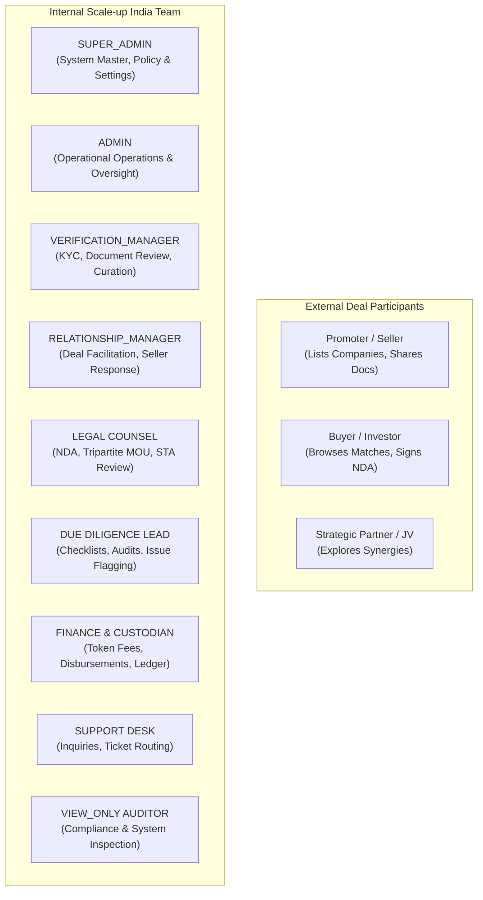

# Scale-up India — Role-Based Access Control (RBAC.md)
*Granular Authorization Matrix and Permission Scopes*

---

## 1. Role Hierarchy & Multi-Role Strategy

Scale-up India distinguishes between **External Platform Participants** (who can hold multiple simultaneous personas, e.g., a Promoter who is also an Investor) and **Internal Staff Personas** (subject to institutional segregation of duties).

---

## 2. Granular Permissions Catalog

| Permission Code | Domain Module | Description |
| :--- | :--- | :--- |
| `users.read` | Users | View user lists, basic profiles, and registration statuses |
| `users.manage_roles` | Users | Assign internal or external roles to accounts |
| `users.suspend` | Users | Suspend or reactivate user accounts with mandatory reason logging |
| `profiles.verify` | Verification | Approve or reject Promoter / Buyer KYC verification |
| `opportunities.create` | Opportunities | Draft and submit new business listings |
| `opportunities.read_all` | Opportunities | Access full unredacted opportunity details across the system |
| `opportunities.verify` | Verification | Mark an opportunity as verified after document audit |
| `opportunities.publish` | Opportunities | Make a verified opportunity visible in matched buyer catalogs |
| `opportunities.archive` | Opportunities | Archive or withdraw listings |
| `documents.upload` | Documents | Upload files to private repository |
| `documents.read_own` | Documents | Access documents uploaded by the authenticated user |
| `documents.read_deal` | Documents | Access documents unlocked via active NDA / deal participation |
| `documents.read_all` | Documents | Internal permission to inspect all documents across deals |
| `documents.approve` | Verification | Approve or reject submitted company/asset documentation |
| `interests.submit` | Interests | Submit Expression of Interest on an opportunity |
| `interests.respond` | Interests | Accept or decline inbound buyer interest (Promoter only) |
| `interests.escalate` | Interests | Intervene in 24-hour SLA overdue interest requests |
| `nda.sign` | Legal | Execute bilateral non-disclosure agreement |
| `mou.draft` | Legal | Generate and customize Tripartite MOU terms and token fees |
| `mou.sign` | Legal | Execute Tripartite MOU (Buyer, Seller, or Scale-up India) |
| `payments.initiate` | Finance | Create token fee or facilitation payment intent |
| `payments.verify` | Finance | Confirm reconciliation of bank NEFT/RTGS or gateway token receipts |
| `payments.refund` | Finance | Authorize refunds in accordance with MOU covenants |
| `due_diligence.manage` | Due Diligence | Create DD cases, assign checklist items, and flag severity issues |
| `valuation.manage` | Valuation | Assign valuation advisors and upload valuation reports |
| `agreements.sign` | Legal | Sign and execute Share Transfer Agreements (STA) |
| `transactions.close` | Finance / Legal| Finalize deal closure, release custodial funds, log settlement |
| `audit.read` | Audit | Inspect immutable audit logs and access histories |
| `settings.manage` | Admin | Configure token fees, match weights, SLA timers, and feature flags |

---

## 3. Comprehensive RBAC Matrix

| Role | User Mgmt | Listing Curation | Doc Review | NDA / MOU | Payments / Custody | DD / Valuation | Audit / Config |
| :--- | :---: | :---: | :---: | :---: | :---: | :---: | :---: |
| **GUEST (Public)** | Register only | Masked Search | None | None | None | None | None |
| **PROMOTER / SELLER** | Own Profile | Own Listings | Own Docs | Sign Own | Pay Own Token | View Own DD | Own Logs |
| **BUYER / INVESTOR** | Own Profile | Matched Listings | Deal Docs (NDA) | Sign Own | Pay Token & Consideration | Request / Review DD | Own Logs |
| **RELATIONSHIP_MGR** | Assigned Users | Read Assigned | Read Assigned | Facilitate | Read Payment Status | Monitor Deal | Read Deal Logs |
| **VERIFICATION_MGR** | Review KYC | Verify & Score | Approve / Reject | None | None | None | Read Verification |
| **LEGAL COUNSEL** | Read Parties | Read All | Legal Review | Draft & Sign MOU | Review Settlement Terms| Review Legal DD | Read Legal Logs |
| **DUE DILIGENCE** | Read Parties | Read All | Technical Audit | None | None | Full DD Items & Reports| Read DD Logs |
| **FINANCE LEAD** | Read Parties | Read All | Financial Docs | None | Verify, Refund & Release| Read Valuations | Read Finance Logs|
| **SUPPORT DESK** | Read Basic | Read Masked | None | None | None | None | None |
| **VIEW_ONLY AUDITOR**| Read All | Read All | Read (Audited) | Read All | Read All | Read All | Read All Logs |
| **ADMIN** | Full Manage | Verify & Publish | Full Review | Coordinate | Review Transactions | Full Management | Read All Logs |
| **SUPER_ADMIN** | Full (Root) | Full (Root) | Full (Root) | Full (Root) | Full (Root) | Full (Root) | Settings & Flags |

---

## 4. Contextual & Relationship Guards

RBAC permissions are not evaluated in isolation. Business rules enforce relationship context:

1. **Promoter Guard**:
   - `assertPromoterOwnsOpportunity(userId, opportunityId)`
   - Promoters can only edit opportunities in `DRAFT` or `ACTION_REQUIRED` status. Once submitted for review, fields become read-only.
2. **Buyer Guard**:
   - `assertBuyerHasSignedNda(buyerId, opportunityId)`
   - Verified buyers cannot view Tier 2/3 company documents or unmasked CINs without an active record in `ndas` matching `status = 'ACTIVE'`.
3. **Assigned Relationship Manager Guard**:
   - Internal staff with `RELATIONSHIP_MANAGER` role can only view full deal room messages and intervene in SLA escalation for deals where `opportunities.assigned_rm_id = userId`.
4. **Finance Disbursal Guard**:
   - Release of custodial funds requires two distinct roles: `LEGAL` must approve the executed STA, and `FINANCE` must authorize the disbursement transaction (Dual-Control Principle).

