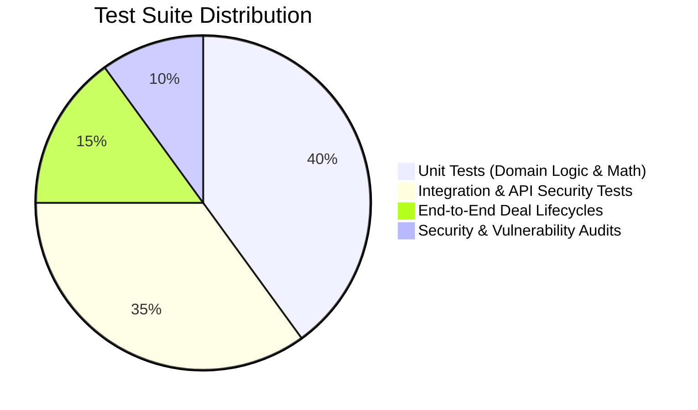
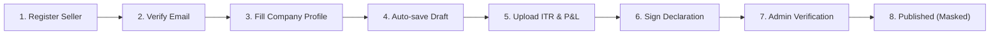

# Scale-up India — Comprehensive Test Plan (TEST_PLAN.md)
*Quality Assurance, Security Verification & End-to-End Testing Strategy*

---

## 1. Testing Strategy & Philosophy

Scale-up India orchestrates high-stakes corporate acquisitions, equity dilutions, and strategic joint ventures. Software bugs or security vulnerabilities risk commercial confidentiality and transactional integrity. 

Testing follows a strict pyramid structure:
1. **Unit Testing**: Isolated logic validation (Zod schemas, readiness scoring, 10-factor matching engine, progressive masking, state transitions).
2. **Integration Testing**: API endpoints, database transactions, RBAC evaluation, anti-IDOR authorization checks, and payment idempotency.
3. **Security Testing**: OWASP Top 10 penetration vectors, magic byte upload checks, parameter tampering, and replay attacks.
4. **End-to-End (E2E) Testing**: Full browser journeys using Playwright simulating realistic multi-party deal executions.

---

## 2. Unit Testing Suite

### 2.1 Profile Readiness Scoring Test Cases
- Verify score calculation yields accurate 0–100 integer given complete vs. partial dataset.
- Confirm statutory document uploads (ITR, Balance Sheet, 26AS) correctly increment documentation sub-score.
- Verify that invalid or negative financial numbers fail validation before scoring.

### 2.2 10-Factor Deterministic Matching Algorithm
- **Industry Compatibility (25%)**: Verify 100% score for exact sector match; 50% for related sub-sector; 0% for disjoint sector.
- **Investment Capacity Alignment (20%)**: Target price within buyer's range scores maximum; out-of-range yields zero or scaled penalty.
- **Transaction Type (15%)**: Verify buyer seeking "Full Buyout" matches seller offering "100% stake sale".
- **Location Compatibility (10%)**: State-level match vs. national preference.
- **Score Explainability**: Verify engine returns human-readable bullet points explaining the match score.

### 2.3 Progressive Data Masking Unit Tests
- Assert unauthenticated user receives masked company name and masked CIN.
- Assert authenticated buyer without signed NDA receives last 2 words of company name and first 15 characters of CIN.
- Assert buyer with active signed NDA receives full legal name and complete 21-character CIN.

---

## 3. Security & Anti-Vulnerability Test Suite

| Test Identifier | Vulnerability Target | Attack Payload / Scenario | Expected Outcome |
| :--- | :--- | :--- | :--- |
| **SEC-01** | IDOR on Opportunities | User B queries `GET /api/v1/opportunities/{Draft_Of_User_A}` | HTTP 404 / 403; access denied |
| **SEC-02** | IDOR on Private Documents | Buyer A queries `GET /api/v1/documents/{Private_ITR_User_B}/url` | HTTP 404; access denied; audit log logged |
| **SEC-03** | Mass Assignment | Buyer submits payload `{ "isAdmin": true, "isVerified": true }` | Payload rejected with HTTP 422 Unprocessable Entity |
| **SEC-04** | Magic Byte MIME Spoofing | Executable ELF/EXE binary renamed to `balance_sheet.pdf` | Upload rejected; quarantined file wiped; HTTP 422 |
| **SEC-05** | Path Traversal in Filename | Filename `../../../../etc/passwd` | Filename sanitized to UUID; path traversal thwarted |
| **SEC-06** | Stored XSS via Upload | SVG with `` uploaded as avatar | SVG upload prohibited; HTTP 422 returned |
| **SEC-07** | Brute Force Protection | 6 consecutive failed password attempts for single email | Account locked for 30 minutes; HTTP 429 Too Many Requests |
| **SEC-08** | Payment Replay | Submitting identical `idempotency_key` with modified amount | Secondary call rejected; initial transaction state returned |
| **SEC-09** | Unauthorized Admin Call | Authenticated Buyer calls `POST /api/v1/admin/opportunities/{id}/verify`| HTTP 403 Forbidden; audit event logged |
| **SEC-10** | Database Injection | Search query with `' OR 1=1; DROP TABLE users; --` | Parameterized query safely treats string as literal |

---

## 4. End-to-End (E2E) Critical Deal Workflows (Playwright)

### FLOW 1: Seller Onboarding & Verification Journey

- **Step 1**: Register as Promoter (`seller@example.com`).
- **Step 2**: Receive session cookie, navigate to `/onboarding/seller`.
- **Step 3**: Enter company CIN, turnover, net worth, employee count, and intent ("Sell 100% Stake").
- **Step 4**: Test auto-save draft functionality by refreshing page; assert data restored.
- **Step 5**: Upload sample PDF financial document; verify upload status.
- **Step 6**: Check statutory declaration box and submit. Profile score displays $\ge$ 80.
- **Step 7**: Admin logs in via `/admin`, reviews curation queue, verifies documents, approves opportunity.
- **Step 8**: Assert opportunity status transitions to `PUBLISHED` and appears in masked catalog.

---

### FLOW 2: Buyer Discovery & Expression of Interest
- **Step 1**: Register as Buyer (`buyer@example.com`) with ₹25Cr investment capacity and Manufacturing sector preference.
- **Step 2**: View `/opportunities`; assert seller listing from Flow 1 appears with masked name ("...Manufacturing Co") and 92% Match Score.
- **Step 3**: Click "Express Interest", complete required prompt ("Acquisition for strategic geographic expansion"), specify 90-day timeline.
- **Step 4**: Assert `interests` record created with 24-hour SLA countdown timer displayed.

---

### FLOW 3: Seller Acceptance & NDA Execution
- **Step 1**: Seller logs in, sees in-app alert and banner: "New Expression of Interest - 23h 48m remaining".
- **Step 2**: Seller clicks "Accept Interest". Status updates to `ACCEPTED`.
- **Step 3**: Bilateral NDA generated; Buyer and Seller both review and click "Sign NDA".
- **Step 4**: Assert digital signature hash generated, status moves to `NDA_SIGNED`, and Buyer now sees unmasked company name and registered office state.

---

### FLOW 4: Tripartite MOU, Token Payment & Due Diligence to Closure
- **Step 1**: Legal Counsel reviews terms and issues Tripartite MOU (token fee: ₹5,000, platform facilitation fee: 2%).
- **Step 2**: Buyer, Seller, and Scale-up India digital signatures recorded.
- **Step 3**: Payment simulation executed for ₹5,000 token fee; server verifies payment idempotently.
- **Step 4**: Deal Room advances to `DD_IN_PROGRESS`. 12-category checklist populated.
- **Step 5**: Due diligence items checked and marked `SATISFIED`.
- **Step 6**: Share Transfer Agreement (STA) drafted, signed by all parties.
- **Step 7**: Custodial transaction marked `CLOSED` and transaction event logged.

---

### FLOW 5: Unauthorized Access & Security Boundary Verification
- **Step 1**: Unauthenticated user attempts to access `/dashboard/seller`; assert redirect to `/login`.
- **Step 2**: Buyer A logs in and attempts direct GET to `/deals/{Deal_Of_Buyer_B}`; assert HTTP 404 / 403 returned.
- **Step 3**: Regular user attempts direct access to `/admin/audit-logs`; assert access denied.

