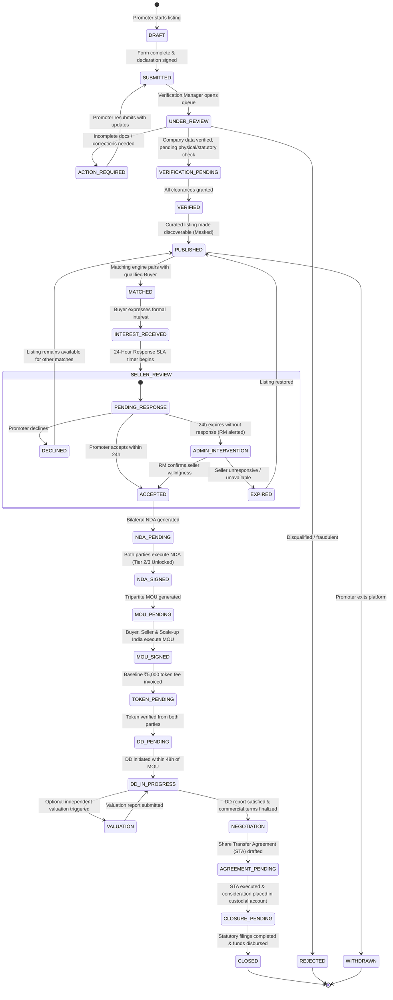

# Scale-up India — Workflow State Machine Specification (WORKFLOW_STATE_MACHINE.md)

---

## 1. Global Transaction Journey State Machine

Scale-up India replaces generic ad-hoc boolean flags with deterministic, strictly validated finite state machines. No state transition occurs without validating:
1. Current State Pre-Conditions
2. Actor Role & Ownership
3. Counterparty Concurrence & Digital Signatures
4. Immutable Audit Event Emission



---

## 2. State Transition Matrix & Enforcement Rules

| Source State | Target State | Permitted Actor | Pre-Conditions & Invariants | Side Effects & Notifications |
| :--- | :--- | :--- | :--- | :--- |
| `DRAFT` | `SUBMITTED` | Promoter (Owner) | Profile Readiness Score $\ge$ 60%; Statutory declaration checked | Emits `OPPORTUNITY_SUBMITTED`; adds to Verification Queue |
| `SUBMITTED` | `UNDER_REVIEW` | Verification Mgr | System lock on listing edits by promoter | Assigns task to Verification Manager |
| `UNDER_REVIEW` | `ACTION_REQUIRED` | Verification Mgr | Rejection reason / missing documents specified | Email sent to Promoter with change checklist |
| `UNDER_REVIEW` | `VERIFIED` | Verification Mgr | MCA CIN checked; ITR/26AS verified; score $\ge$ 75% | Emits `OPPORTUNITY_VERIFIED`; readiness badge updated |
| `VERIFIED` | `PUBLISHED` | Admin / System | Admin publication clearance; RM assigned | Runs Matching Engine against verified Buyer profiles |
| `PUBLISHED` | `INTEREST_RECEIVED`| Verified Buyer | Investment capacity covers min valuation range | Creates `interests` record; starts 24-hour response countdown |
| `SELLER_REVIEW`| `ACCEPTED` | Promoter (Owner) | Within 24 hours of interest creation | Dispatches email to Buyer; triggers Bilateral NDA creation |
| `SELLER_REVIEW`| `ADMIN_INTERVENTION`| System (Cron) | Current time $>$ `response_deadline` and status is `PENDING` | Creates Urgent Task for assigned RM: "Seller Response Overdue" |
| `NDA_PENDING` | `NDA_SIGNED` | Buyer & Seller | Both digital signature hashes and timestamps recorded | Unmasks company name (Tier 2); unlocks deal discussion room |
| `NDA_SIGNED` | `MOU_PENDING` | Legal Counsel | Tripartite MOU generated with custom token and facilitation fee| Notifies all 3 parties to review and sign |
| `MOU_PENDING` | `MOU_SIGNED` | Buyer, Seller, ICS | All three digital signatures logged with SHA-256 integrity | Transitions deal room into financial clearance phase |
| `MOU_SIGNED` | `TOKEN_PENDING` | System | Generates payment order for token fees | Dispatches payment gateway links / NEFT virtual accounts |
| `TOKEN_PENDING`| `DD_PENDING` | Finance Lead | Verified receipt of token payment from both parties | Sets 48-hour SLA deadline for Due Diligence kick-off |
| `DD_PENDING` | `DD_IN_PROGRESS` | DD Lead / Buyer | Scope defined (Scale-up India internal team or Buyer advisor)| Generates 12-category DD checklist |
| `DD_IN_PROGRESS`| `NEGOTIATION` | Buyer & DD Lead | All Critical/High severity issues resolved or waived | Unlocks STA drafting stage |
| `NEGOTIATION` | `AGREEMENT_PENDING`| Legal Counsel | Commercial terms, price per share, warranties agreed | Uploads final draft STA for formal execution |
| `AGREEMENT_PENDING`| `CLOSURE_PENDING` | Legal Counsel | STA signed by all statutory signatories | Funds deposited into designated custodial account |
| `CLOSURE_PENDING` | `CLOSED` | Finance & Legal | MCA filing (Form SH-4, DIR-12) confirmed; funds released | Deal logged as completed; final audit report sealed |

---

## 3. The 24-Hour Seller SLA Engine

```mermaid
sequenceDiagram
    autonumber
    actor Buyer
    participant Engine as SLA Engine
    actor Seller
    actor RM as Relationship Mgr

    Buyer->>Engine: Express Interest (T = 0h)
    Engine->>Seller: In-App Alert + Email: "New Verified Buyer Interest Received"
    Note over Engine: Set response_deadline = T + 24 Hours

    alt Seller Responds within 24h
        Seller->>Engine: Accept Interest (T = 6h)
        Engine->>Buyer: "Seller Accepted! NDA Ready for Execution"
        Engine->>Engine: Transition to NDA_PENDING
    else SLA Breached (T = 24h 01m)
        Engine->>Engine: Mark status: ADMIN_INTERVENTION
        Engine->>RM: Urgent Task: "Seller Response Overdue for OP-2026-M041"
        RM->>Seller: Direct telephone / personal briefing
        alt Seller confirms willingness
            RM->>Engine: Mark Accepted on behalf of seller with recorded consent
            Engine->>Buyer: "Seller Confirmed! Proceeding to NDA"
        else Seller declines or unavailable
            RM->>Engine: Mark Expired / Declined
            Engine->>Buyer: "Seller unavailable; exploring alternative matches"
        end
    end
```

---

## 4. Due Diligence Issue Severity & Resolution Engine

Each DD checklist item undergoes a deterministic resolution pipeline:

1. **Category Assignment**: Checklist item assigned across 12 statutory heads (Corporate, Financial, Tax, Legal, Regulatory, Operational, Assets, Employees, Litigation, Contracts, IP, Compliance).
2. **Issue Logging**:
   - `CRITICAL`: Immediate deal-breaker (e.g., undisclosed insolvency petition, major tax lien). Blocks progression to `NEGOTIATION`.
   - `HIGH`: Material discrepancy (e.g., expired environmental clearance). Requires promoter remediation or price adjustment.
   - `MEDIUM`: Rectifiable deficiency (e.g., missing board resolution for asset charge).
   - `LOW`: Minor documentation clerical error.
3. **Closure Condition**: A deal can only advance to `AGREEMENT_PENDING` when zero `CRITICAL` or `HIGH` issues remain in `PENDING` or `ISSUE_FLAGGED` status without an explicit written waiver executed by the Buyer.

