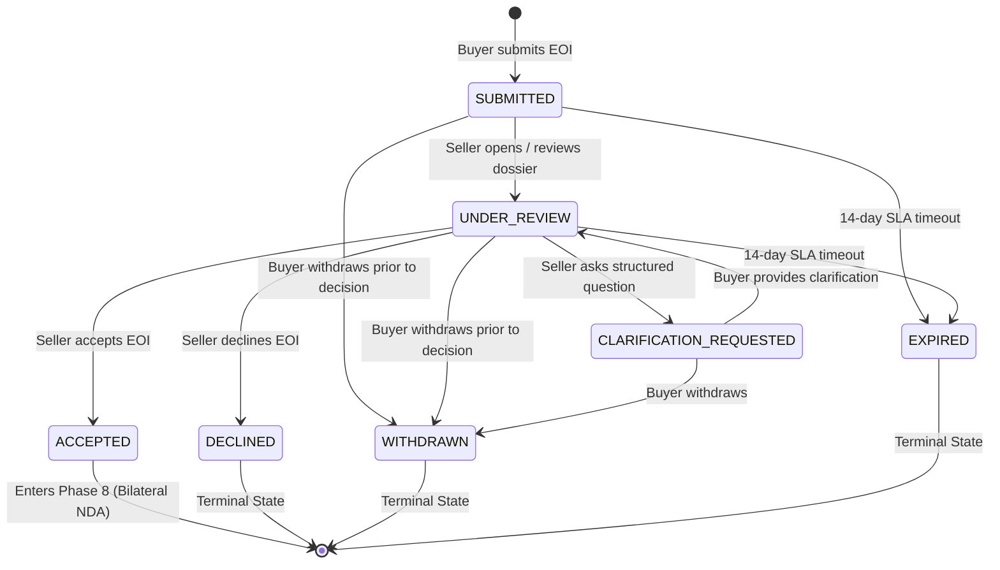

# SCALE-UP INDIA — PHASE 7 ARCHITECTURE & IMPLEMENTATION PLAN
## Expression of Interest (EOI) & Bilateral Interest Workflow

**Document Reference**: `docs/PHASE_7_PLAN.md`  
**Execution Date**: 2026-11-14  
**Author**: Engineering Core  
**Current Phase**: Phase 7 (EOI Workflow)  
**Target Milestone**: `READY_FOR_PHASE_8`  

---

### 1. Executive Summary & Core Objective

The Expression of Interest (EOI) workflow is the critical commercial bridge connecting prospective buyers/investors with business opportunities published on Scale-up India. It establishes a formal, non-binding expression of serious acquisition intent between an authenticated buyer and a verified seller, while strictly preserving progressive data masking on both sides.

#### Key Invariants & Architectural Boundaries
1. **Zero Premature Confidentiality Unlocking**:
   - Submitting or accepting an EOI does **NOT** constitute an NDA.
   - Submitting or accepting an EOI does **NOT** transfer ownership or create a binding acquisition agreement.
   - Submitting or accepting an EOI does **NOT** reveal statutory credentials (CIN, GSTIN, PAN, exact address, audited accounts, or private seller document vaults).
2. **Bilateral Privacy & Data Protection**:
   - Sellers receive a structured, anonymized/safe **Buyer Summary** (Entity Type, Target Sector, Indicative Deal Size, Investment Horizon, Message, Match Score). Sellers **never** see buyer private financial statements, unshared mandates, AUM details, or documents.
   - Buyers review only Tier 0 / Tier 1 masked opportunity data.
3. **Strict Server-Side State Machine**:
   - All state transitions (`SUBMITTED`, `UNDER_REVIEW`, `ACCEPTED`, `DECLINED`, `CLARIFICATION_REQUESTED`, `WITHDRAWN`, `EXPIRED`) are validated server-side.
   - No client-side status injection, actor ID tampering, or mass assignment.
4. **Database-Backed Anti-Duplication & Concurrency Protection**:
   - A PostgreSQL Partial Unique Index prevents concurrent or duplicate active EOIs for the same `(buyer_id, opportunity_id)`.
5. **Truthful Notification & Audit Trail**:
   - Persisted in-app notifications and immutable audit log entries. No fake "email sent" claims.

---

### 2. EOI Lifecycle & State Machine



#### Transition Invariants
- `DECLINED -> ACCEPTED`: **FORBIDDEN**
- `ACCEPTED -> SUBMITTED`: **FORBIDDEN**
- `WITHDRAWN -> ACCEPTED`: **FORBIDDEN**
- `EXPIRED -> ACCEPTED`: **FORBIDDEN**
- Only the buyer who owns the EOI can trigger `WITHDRAWN`.
- Only the seller who owns the opportunity can trigger `ACCEPTED`, `DECLINED`, or `CLARIFICATION_REQUESTED`.
- Active states: `SUBMITTED`, `UNDER_REVIEW`, `CLARIFICATION_REQUESTED`, `ACCEPTED`. Only one active EOI per `(buyer_id, opportunity_id)` is allowed at any time.

---

### 3. Database Architecture (Migration 007)

#### 3.1 Table: `expressions_of_interest`
- `id UUID PRIMARY KEY DEFAULT gen_random_uuid()`
- `reference_code VARCHAR(50) NOT NULL UNIQUE` (Sequence: `eoi_ref_seq` starting at 10001, e.g. `EOI-2026-10001`)
- `opportunity_id UUID NOT NULL REFERENCES opportunities(id) ON DELETE CASCADE`
- `buyer_id UUID NOT NULL REFERENCES users(id) ON DELETE CASCADE`
- `buyer_profile_id UUID NOT NULL REFERENCES buyer_profiles(id) ON DELETE CASCADE`
- `mandate_id UUID REFERENCES acquisition_mandates(id) ON DELETE SET NULL`
- `seller_id UUID NOT NULL REFERENCES users(id) ON DELETE CASCADE`
- `seller_profile_id UUID NOT NULL REFERENCES seller_profiles(id) ON DELETE CASCADE`
- `status VARCHAR(50) NOT NULL DEFAULT 'SUBMITTED'`
- `interest_type VARCHAR(100) NOT NULL` (`FULL_ACQUISITION`, `MAJORITY_STAKE`, `MINORITY_STAKE`, `STRATEGIC_INVESTMENT`, `JOINT_VENTURE`, `PARTNERSHIP`, `OTHER`)
- `proposed_transaction_type VARCHAR(100) NOT NULL`
- `indicative_offer_range VARCHAR(50)` (`UNDER_10CR`, `10CR_TO_25CR`, `25CR_TO_50CR`, `50CR_TO_100CR`, `OVER_100CR`, `NEGOTIABLE`)
- `investment_timeline VARCHAR(50) NOT NULL` (`IMMEDIATE_30_DAYS`, `1_TO_3_MONTHS`, `3_TO_6_MONTHS`, `FLEXIBLE`)
- `buyer_message TEXT NOT NULL`
- `seller_response_message TEXT`
- `seller_decline_reason VARCHAR(100)`
- `clarification_questions TEXT`
- `clarification_answers TEXT`
- `created_at TIMESTAMPTZ DEFAULT CURRENT_TIMESTAMP`
- `updated_at TIMESTAMPTZ DEFAULT CURRENT_TIMESTAMP`
- `submitted_at TIMESTAMPTZ DEFAULT CURRENT_TIMESTAMP`
- `reviewed_at TIMESTAMPTZ`
- `accepted_at TIMESTAMPTZ`
- `declined_at TIMESTAMPTZ`
- `withdrawn_at TIMESTAMPTZ`
- `expires_at TIMESTAMPTZ DEFAULT (CURRENT_TIMESTAMP + INTERVAL '14 days')`

#### 3.2 Database Indexes & Constraints
```sql
-- PostgreSQL Partial Unique Index for Active EOI Deduping
CREATE UNIQUE INDEX idx_eoi_active_buyer_opp 
ON expressions_of_interest (buyer_id, opportunity_id) 
WHERE status IN ('SUBMITTED', 'UNDER_REVIEW', 'CLARIFICATION_REQUESTED', 'ACCEPTED');

-- Covering indexes for fast buyer and seller inboxes
CREATE INDEX idx_eoi_buyer_inbox ON expressions_of_interest (buyer_id, created_at DESC);
CREATE INDEX idx_eoi_seller_inbox ON expressions_of_interest (seller_id, status, created_at DESC);
CREATE INDEX idx_eoi_opportunity ON expressions_of_interest (opportunity_id, status);
```

#### 3.3 Table: `in_app_notifications`
```sql
CREATE TABLE IF NOT EXISTS in_app_notifications (
    id UUID PRIMARY KEY DEFAULT gen_random_uuid(),
    user_id UUID NOT NULL REFERENCES users(id) ON DELETE CASCADE,
    type VARCHAR(100) NOT NULL,
    title VARCHAR(255) NOT NULL,
    message TEXT NOT NULL,
    resource_type VARCHAR(100),
    resource_id UUID,
    is_read BOOLEAN NOT NULL DEFAULT FALSE,
    read_at TIMESTAMPTZ,
    created_at TIMESTAMPTZ DEFAULT CURRENT_TIMESTAMP
);
CREATE INDEX idx_notifications_user_unread ON in_app_notifications(user_id, is_read, created_at DESC);
```

---

### 4. Authorization & Anti-IDOR Matrix

| Action | Allowed Roles | Enforcement Mechanism |
| :--- | :--- | :--- |
| **Submit EOI** | `BUYER`, `INDIVIDUAL_INVESTOR`, `INSTITUTIONAL_BUYER` | Active session, verified buyer profile, opportunity must be `PUBLISHED`, buyer $\neq$ seller, zero active duplicate EOI. |
| **View Own Submitted EOIs** | `BUYER` (Owner) | Query restricted to `WHERE buyer_id = session.user.id`. |
| **Withdraw Own EOI** | `BUYER` (Owner) | Must match `buyer_id = session.user.id` and status must be in `['SUBMITTED', 'UNDER_REVIEW', 'CLARIFICATION_REQUESTED']`. |
| **View Received EOIs** | `SELLER` (Opportunity Owner) | Query restricted to `WHERE seller_id = session.user.id`. |
| **Accept / Decline EOI** | `SELLER` (Opportunity Owner) | Verification that `seller_id = session.user.id` and status is `SUBMITTED` or `UNDER_REVIEW`. |
| **Admin Oversight** | `SUPER_ADMIN`, `ADMIN` | Read-only listing for compliance and dispute monitoring. |

---

### 5. API Contracts

1. `POST /api/v1/opportunities/[opportunityId]/eoi`: Submit Expression of Interest.
2. `GET /api/v1/buyer/eois`: Retrieve buyer's submitted EOIs with pagination and status filters.
3. `GET /api/v1/buyer/eois/[eoiId]`: Retrieve individual EOI details for buyer.
4. `POST /api/v1/buyer/eois/[eoiId]/withdraw`: Buyer withdraws submitted EOI.
5. `GET /api/v1/seller/eois`: Retrieve seller's received EOIs with opportunity filter.
6. `GET /api/v1/seller/eois/[eoiId]`: Retrieve individual EOI safe buyer summary for seller.
7. `POST /api/v1/seller/eois/[eoiId]/accept`: Seller accepts EOI.
8. `POST /api/v1/seller/eois/[eoiId]/decline`: Seller declines EOI with structured reason.
9. `POST /api/v1/seller/eois/[eoiId]/clarify`: Seller requests structured clarification.
10. `GET /api/v1/notifications`: List buyer/seller notifications.
11. `PATCH /api/v1/notifications/[notificationId]/read`: Mark notification read.

---

### 6. Implementation Steps & Milestones

1. **Plan & Rules Documentation**: Create `docs/PHASE_7_PLAN.md` and `docs/PHASE_7_EOI_RULES.md`.
2. **Database Migration**: Create `src/lib/migrations/007_expression_of_interest.sql`.
3. **Domain Service & Schemas**:
   - `src/schemas/eoi.ts`: Validation schemas for submission, decline, clarify, and queries.
   - `src/types/eoi.ts`: TypeScript contracts for EOI records and safe views.
   - `src/domains/eoi/service.ts`: Core business logic, state transitions, Anti-IDOR, and masking.
   - `src/domains/notifications/service.ts`: In-app notification creation and read tracking.
4. **API Routes**: Create Next.js API endpoints for buyer and seller EOI workflows.
5. **Frontend UI**:
   - Upgrade `/opportunities/[opportunityId]` with Express Interest modal and active EOI banner.
   - Create `/buyer/eois/page.tsx` for buyer EOI portfolio tracking.
   - Create `/seller/eois/page.tsx` for seller EOI inbox and review actions.
6. **Tests & Quality Verification**:
   - Create `tests/eoi_workflow.test.ts` with 35+ comprehensive tests.
   - Create `scripts/phase7_security_gate.ts` verifying all 20+ invariants.
   - Run typecheck, lint, full vitest suite (24 suites), Next.js build, and live dev smoke tests.
7. **Reporting & Completion**:
   - Write `docs/PHASE_7_REPORT.md` and `docs/PHASE_7_FINAL_GATE.md`.
   - Update `docs/IMPLEMENTATION_STATUS.md`.
   - Output exact verdict: `READY_FOR_PHASE_8`.
