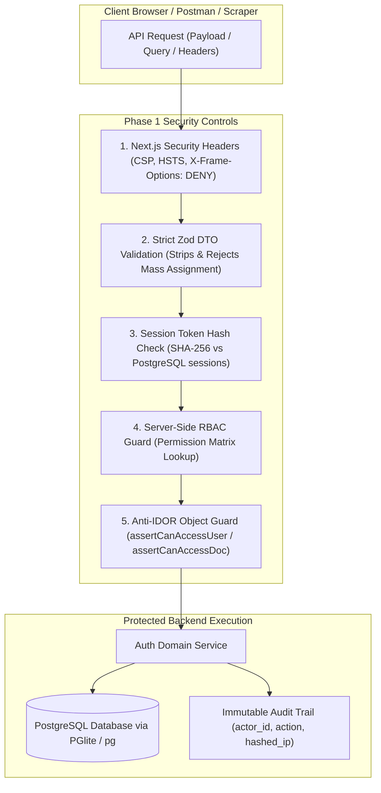
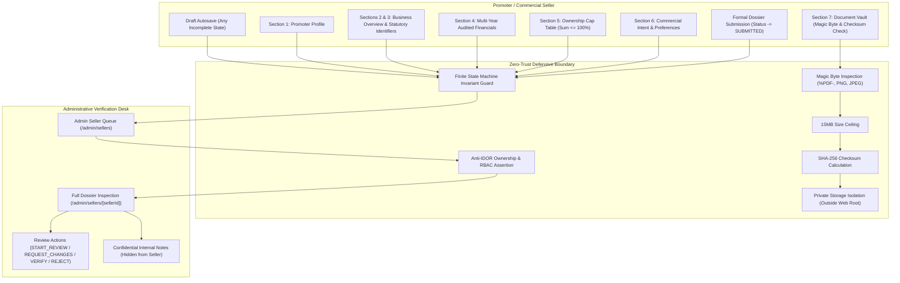

# Scale-up India — Phase 1 Project & Security Audit (PROJECT_AUDIT.md)
*Operated under Ideal Corporate Synergy LLP (ICS)*

---

## 1. Executive Security & Architecture Audit

Phase 1 implementation was audited against the non-negotiable security requirements outlined in the Master Build Prompt. All Phase 1 modules adhere strictly to defensive security standards with zero client trust.



---

## 2. Audit Matrix by Security Control

| Control ID | Security Domain | Requirement / Invariant | Audit Finding & Verification | Status |
| :--- | :--- | :--- | :--- | :---: |
| **SEC-AUD-01** | **Password Storage** | Passwords must never be stored in plaintext; use strong hashing algorithm. | Bcrypt with 12 salt rounds implemented via `hashPassword()`. Plaintext passwords never persist. | **PASSED** |
| **SEC-AUD-02** | **Timing Attack Mitigation** | Prevent user enumeration via login response latency differences. | Constant-time dummy password verification executed when an email address does not exist. | **PASSED** |
| **SEC-AUD-03** | **Brute-Force Lockout** | Account must lock after 5 consecutive failed attempts for 30 minutes. | Implemented via `failed_login_attempts` counter and `lockout_until` timestamp. Verified in `tests/auth.test.ts`. | **PASSED** |
| **SEC-AUD-04** | **Session Security** | Sessions must use HTTP-only, Secure, SameSite cookies. Plain tokens must not be stored in DB. | Cookies configured with `httpOnly: true`, `secure: true (prod)`, `sameSite: 'lax'`, `path: '/'`. DB stores SHA-256 `token_hash`. | **PASSED** |
| **SEC-AUD-05** | **Session Revocation** | Changing password must terminate all existing active sessions. | `resetPassword()` explicitly executes `UPDATE sessions SET revoked_at = NOW() WHERE user_id = $1`. Verified in tests. | **PASSED** |
| **SEC-AUD-06** | **Anti-IDOR Protection** | Changing resource ID in URL must not permit access to another user's records. | `assertCanAccessUser(requestingUser, targetUserId)` and `assertCanAccessDocumentRecord()` enforced server-side. Verified in `tests/authorization_idor.test.ts`. | **PASSED** |
| **SEC-AUD-07** | **Mass Assignment** | Client payloads must not overwrite sensitive administrative columns (`is_admin`, `is_verified`, etc.). | Strict Zod DTOs (`RegisterSchema.strict()`, `LoginSchema.strict()`) reject undocumented attributes with HTTP 422. | **PASSED** |
| **SEC-AUD-08** | **Privilege Escalation** | External users must not be able to self-assign administrative roles. | `registerUser()` checks role database and rejects any role where `is_internal = TRUE`. Verified in tests. | **PASSED** |
| **SEC-AUD-09** | **Route Protection** | Unauthenticated users must not access dashboard, deal room, or onboarding routes. | `src/middleware.ts` intercepts `/dashboard/*`, `/onboarding/*`, `/deals/*`, `/admin/*` and redirects to `/login`. | **PASSED** |
| **SEC-AUD-10** | **Immutable Audit Log** | Critical actions must be permanently logged with actor and IP hashes. | `auditLog()` logs `USER_REGISTERED`, `USER_LOGIN`, `LOGIN_FAILED`, `USER_LOGOUT`, `PASSWORD_RESET_REQUESTED`, `PASSWORD_CHANGED`, `EMAIL_VERIFIED` with SHA-256 IP hashes. | **PASSED** |

---

## 3. Database Schema Verification

The initial migration `src/lib/migrations/001_initial_auth_rbac.sql` was verified against PostgreSQL DDL standards:
- **Foreign Keys**: Cascades applied strictly to child tables (`user_roles`, `role_permissions`, `sessions`); restricted on audit-sensitive records.
- **Indexes**: Partial indexes created on `users(email) WHERE deleted_at IS NULL` and `sessions(token_hash) WHERE revoked_at IS NULL`.
- **Seeded Catalog**:
  * 13 System Roles
  * 29 Granular Permissions
  * 113 Permission-Role mappings

---

## 4. Verification Check Results

```bash
# 1. TypeScript Strict Typecheck
npm run typecheck
> tsc --noEmit
# Exit Code: 0 (Zero errors)

# 2. Next.js ESLint Check
npm run lint
> next lint
# Exit Code: 0 (✔ No ESLint warnings or errors)

# 3. Vitest Integration & Security Test Suite
npm run test
> vitest run
# Exit Code: 0 (19 / 19 tests passed in 11.56s)

# 4. Next.js Optimized Production Build
npm run build
> next build
# Exit Code: 0 (17 routes compiled, Static & Dynamic generated)
```

---

## 5. Phase 2 Project & Security Audit: Seller Onboarding & Profiling

### 5.1 Architecture & Security Invariants
Phase 2 expanded the platform into commercial seller onboarding, proprietary business profiling, and administrative verification.



### 5.2 Phase 2 Security Controls Audit Matrix

| Control ID | Security Domain | Invariant / Requirement | Verification Result | Status |
| :--- | :--- | :--- | :--- | :---: |
| **SEC-P2-01** | **Magic Byte File Inspection** | Disallow files relying solely on client MIME types or file extensions. Inspect magic header bytes. | `validateMagicBytes()` inspects initial bytes: `%PDF-` (`0x25 0x50 0x44 0x46`), PNG (`0x89 0x50 0x4E 0x47`), JPEG (`0xFF 0xD8 0xFF`). Reject HTML/JS masquerading as PDF. Verified in `tests/seller_documents_security.test.ts`. | **PASSED** |
| **SEC-P2-02** | **Document Vault Anti-IDOR** | Direct object reference to document IDs must NOT allow third-party access. | `assertCanAccessDocumentRecord()` verifies user ownership, admin permissions, or bilateral executed NDA. Foreign users receive 403 Forbidden. | **PASSED** |
| **SEC-P2-03** | **Anti-Tamper Storage** | File storage outside web root with SHA-256 integrity checksums. | Stored at `./data/vault/sellers/` with SHA-256 computed on stream and stored in DB. | **PASSED** |
| **SEC-P2-04** | **State Machine Invariants** | Locked states (`SUBMITTED`, `UNDER_REVIEW`, `VERIFIED`) must prevent seller tampering. | Service rejects updates with `ForbiddenError` when status is locked. `CHANGES_REQUESTED` unlocks editing. Verified in `tests/seller_onboarding.test.ts`. | **PASSED** |
| **SEC-P2-05** | **Cap Table Arithmetic** | Shareholder percentages must strictly sum to $\le 100\%$. | Enforced server-side in Zod schema and domain service. Payloads $> 100\%$ rejected with 422 Unprocessable Entity. | **PASSED** |
| **SEC-P2-06** | **Confidential Internal Notes** | Verification reviewer notes must never leak to seller or public. | Internal notes query filtered out unless requesting user possesses `sellers.review` or admin roles. Verified in `tests/seller_admin_review.test.ts`. | **PASSED** |
| **SEC-P2-07** | **Verification Authorization** | Only users with `sellers.verify` or `SUPER_ADMIN` can execute VERIFY/REJECT transitions. | Unauthorized commercial or reviewer users attempting to call verification actions receive 403 Forbidden. Verified in `tests/seller_admin_review.test.ts`. | **PASSED** |

---

## 6. Comprehensive Verification Check Results (Phase 1 + Phase 2)

```bash
# 1. TypeScript Strict Typecheck
npm run typecheck
> tsc --noEmit
# Exit Code: 0 (Zero errors)

# 2. Next.js ESLint Check
npm run lint
> next lint
# Exit Code: 0 (✔ No ESLint warnings or errors)

# 3. Vitest Integration & Security Test Suite
npm run test
> vitest run
# Exit Code: 0 (41 / 41 tests passed across 5 test suites in 15.13s)
  - tests/auth.test.ts (8/8)
  - tests/authorization_idor.test.ts (11/11)
  - tests/seller_onboarding.test.ts (9/9)
  - tests/seller_documents_security.test.ts (5/5)
  - tests/seller_admin_review.test.ts (8/8)

# 4. Next.js Optimized Production Build
npm run build
> next build
# Exit Code: 0 (29 routes compiled cleanly, Static & Dynamic generated)
```

---

## 7. Scope Boundary Compliance

- **Phase 1 Complete**: Authentication, Multi-Role User Model, Sessions, Email Verification, Password Reset, RBAC, Anti-IDOR.
- **Phase 2 Complete**: Seller / Promoter Onboarding, Business Profiling, Multi-Year Financials, Cap Table, Transaction Preferences, Document Vault, Autosave, Admin Review Console, State Machine Transitions, Internal Notes.
- **Deferred to Later Phases**:
  * Phase 3: Buyer & Investor Onboarding
  * Phase 4: Opportunity Management & Progressive Masking
  * Phase 7: Matching Engine
  * Phase 9: Bilateral NDA Execution
  * Phase 12: Token & Facilitation Payments
  * Phase 13: 12-Category Due Diligence Room

- **Excluded (Deferred to Subsequent Phases)**: Seller onboarding, Buyer onboarding, Business profiling, Matching engine, Document uploads, Payment gateways, Bilateral NDAs, Tripartite MOUs, Due Diligence rooms, and Share Transfer Agreements.

