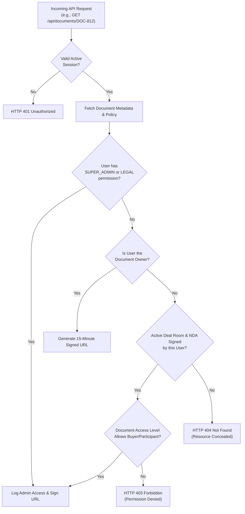
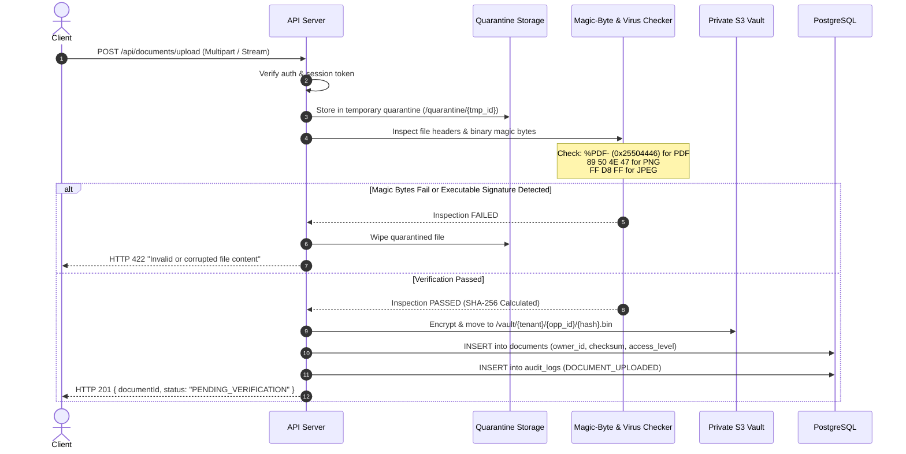

# Scale-up India — Enterprise Security Model (SECURITY_MODEL.md)

---

## 1. Threat Model & Security Posture

Scale-up India handles proprietary financial disclosures, CINs, tax filings (ITR, 26AS), board resolutions, and acquisition deal terms for Indian enterprises. Confidentiality is the core value proposition. A data leak destroys promoter trust and deal integrity.

### Core Threat Vectors Addressed
1. **Insecure Direct Object Reference (IDOR)**: Tampering with opportunity IDs (`/opportunities/OP-1002`), document IDs (`/documents/DOC-501`), or conversation IDs (`/conversations/124`).
2. **Mass Assignment & Parameter Tampering**: Submitting client payloads containing `isAdmin: true`, `verificationStatus: "VERIFIED"`, `matchScore: 99`, or altered `token_amount`.
3. **MIME Spoofing & File Upload Exploits**: Uploading executable payloads disguised as `.pdf` or `.png` to compromise server infrastructure.
4. **Data Exfiltration via Public Scraping**: Scraping business directories to identify vulnerable promoters facing financial distress.
5. **Credential Stuffing & Session Fixation**: Brute-force attacks on promoter accounts.

---

## 2. Server-Side Object-Level Authorization (Anti-IDOR)

Every protected resource access executes strict authorization logic server-side. Client session identity is derived exclusively from the verified HTTP-only session cookie.



### Server Authorization Rule Implementation
```typescript
export async function assertCanAccessDocument(
  user: AuthenticatedUser, 
  documentId: string
): Promise<DocumentRecord> {
  const doc = await db.document.findUnique({ where: { id: documentId, deletedAt: null } });
  if (!doc) throw new NotFoundError("Document not found");

  // 1. Owner always has full access
  if (doc.ownerId === user.id) return doc;

  // 2. Admins with specific document read permissions
  if (user.permissions.includes("documents.read_all")) {
    await auditLog({ actorId: user.id, action: "ADMIN_VIEW_DOCUMENT", resourceId: documentId });
    return doc;
  }

  // 3. Check progressive NDA & MOU access for counterparty
  const activeNda = await db.nda.findFirst({
    where: {
      opportunityId: doc.opportunityId,
      buyerUserId: user.id,
      status: "ACTIVE"
    }
  });

  if (!activeNda) {
    // Return 404 to obscure the document's existence
    throw new NotFoundError("Document not found");
  }

  // Ensure document access level is permitted under active NDA
  const permittedLevels = ["VERIFIED_BUYER", "NDA_REQUIRED", "TRANSACTION_PARTY"];
  if (!permittedLevels.includes(doc.accessLevel)) {
    throw new ForbiddenError("Insufficient authorization tier for this document");
  }

  return doc;
}
```

---

## 3. Strict Input Whitelisting (Mass Assignment Prevention)

Client requests are validated against strict Zod DTOs. Any undocumented parameter is stripped or rejected outright.

```typescript
// Example: Seller Company Update DTO
export const UpdateCompanySchema = z.object({
  businessObjective: z.string().min(20).max(2000),
  employeeCount: z.number().int().positive(),
  expectedPrice: z.number().positive(),
  stakeOfferedPercentage: z.number().min(1).max(100),
  // NEVER allow client to submit: verificationStatus, isVerified, assignedRmId, createdAt
}).strict(); // Throws error on unpermitted keys
```

---

## 4. Multi-Stage Secure Document Upload Pipeline

Uploaded documents undergo a 5-step sanitization and verification pipeline before entering the private vault.



### Disallowed File Types & Rules
- Strictly permitted extensions: `.pdf`, `.png`, `.jpg`, `.jpeg`.
- Disallowed: `.exe`, `.sh`, `.bat`, `.svg` (prevents stored XSS via SVG scripts), `.html`, `.php`, `.js`, `.zip`.
- Max upload limit: 15MB per file.

---

## 5. Privacy-Preserving Progressive Data Masking

To maintain transaction discretion, seller entities are scrubbed of identifying markers until a bilateral NDA is executed.

| Field | Public / Unverified View | Verified Buyer View | Active NDA View | Deal Room / MOU View |
| :--- | :--- | :--- | :--- | :--- |
| **Headline** | "Specialty Chemicals Manufacturer" | "Specialty Chemicals Manufacturer" | "Specialty Chemicals Manufacturer" | "Specialty Chemicals Manufacturer" |
| **Company Legal Name** | *Hidden* | Last two words only (e.g. "...Chem Tech") | Full Legal Name | Full Legal Name |
| **CIN Number** | *Hidden* | First 15 characters only | Full CIN (21 chars) | Full CIN |
| **Location** | Region (e.g., "Western India") | State (e.g., "Gujarat") | District & City | Registered Office Address |
| **Turnover** | Band (e.g., "₹25Cr - ₹50Cr") | Audited Turnover Range | Exact Audited Turnover | Complete P&L Statements |
| **Promoter Identity**| *Hidden* | *Hidden* | Promoter Name & Role | Full KYC & Contact Details |
| **Financial Docs** | *None* | *None* | Summary Sheet | Full Audited Balance Sheets |

---

## 6. Authentication, Session & Cookie Security

1. **Password Hashing**: Argon2id with 64MB memory cost, 3 iterations, and parallelism of 4.
2. **Session Cookies**:
   - `HttpOnly`: Inaccessible to JavaScript (mitigating XSS session theft).
   - `Secure`: Transmitted strictly over TLS (HTTPS).
   - `SameSite=Lax`: Prevents CSRF on state-changing cross-site navigations.
   - `Path=/`: Scoped to domain root.
3. **Brute Force Countermeasures**:
   - Max 5 failed attempts per IP/Account within a 15-minute window.
   - Exponential delay and temporary account lock for 30 minutes upon threshold breach.
   - Immediate notification dispatched to user email on new login from unseen user agent.
4. **Session Termination**:
   - Single-device logout wipes cookie and revokes session record in DB.
   - "Logout all sessions" revokes all active session records for the user.

---

## 7. Security Headers & Defense Config

```http
Content-Security-Policy: default-src 'self'; script-src 'self' 'unsafe-inline'; style-src 'self' 'unsafe-inline'; img-src 'self' data: https:; font-src 'self'; object-src 'none'; frame-ancestors 'none'; base-uri 'self'; form-action 'self';
Strict-Transport-Security: max-age=63072000; includeSubDomains; preload
X-Content-Type-Options: nosniff
X-Frame-Options: DENY
Referrer-Policy: strict-origin-when-cross-origin
Permissions-Policy: camera=(), microphone=(), geolocation=(), payment=(self)
```

---

## 8. Phase 3 Implemented Security Controls: Buyer / Investor Data Defense

1. **Anti-IDOR Object Authorization**:
   - Every buyer profile, acquisition mandate, and vault document is resolved against `user.id` derived strictly from the server-side session token hash.
   - Cross-tenant access is rejected with `403 Forbidden` (`assertBuyerOwnsMandate`, `assertCanAccessDocumentRecord`).
2. **Mandate Range Arithmetic Validation**:
   - Zero client trust: `minInvestment <= maxInvestment`, `revenueMin <= revenueMax`, `ebitdaMin <= ebitdaMax`, `employeeMin <= employeeMax`.
   - Prevent negative numbers, NaN, and inverted logic.
3. **Magic-Byte Binary Inspection & Anti-Tamper Vaulting**:
   - Buyer documents undergo strict binary signature inspection (`%PDF-`, PNG, JPEG) and SHA-256 integrity verification.
   - Files are stored outside the web root (`./data/vault/buyers/`).
4. **Privilege-Separated Verification & Suspension**:
   - External commercial users cannot self-assign internal administrative roles or set their status to `VERIFIED`.
   - Admin actions (`VERIFY`, `REJECT`, `SUSPEND`) are gated behind granular permissions (`buyers.verify`, `buyers.suspend`).
5. **Confidential Internal Notes Partitioning**:
   - Diligence review notes logged by verification officers are stored in `buyer_internal_notes` and completely stripped from external buyer API responses.


